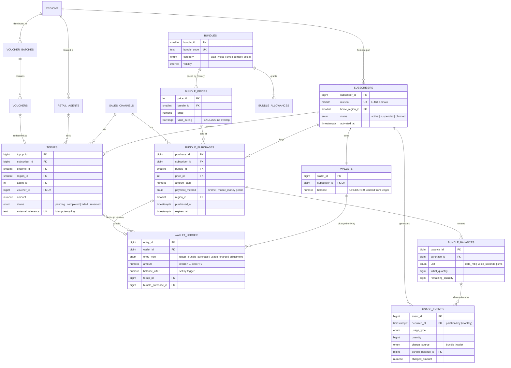

# Prepaid Mobile Network Database

[](https://github.com/TeereraiKagura/prepaid-telco-db/actions/workflows/ci.yml)


A PostgreSQL database for the prepaid side of a mobile network operator:
**airtime wallets, top-ups, scratch-card vouchers, data/voice/SMS bundles and usage charging**.
It includes a reproducible 12-month synthetic dataset and **15 SQL queries that answer real business
questions**, such as *"Which bundles sell best by region?"*

The data belongs to *Zambezi Mobile*, a fictional operator in Zimbabwe's 10 provinces.

---

## Highlights

- **Ledger-based money model.** Every airtime movement is an immutable ledger entry. Balances can't be
  edited directly, can't go negative, and always reconcile to the ledger (enforced by triggers and checked in CI).
- **Integrity in the database.** E.164 phone-number domain, `CHECK` constraints, and a
  `tstzrange` exclusion constraint that makes overlapping bundle prices impossible.
- **Transactional business operations.** Top-up (idempotent on the gateway reference), voucher redemption
  (no double-spend), bundle purchase and online charging (bucket draw-down, then pay-as-you-go), each one atomic with row locking.
- **Built for volume.** Usage events are range-partitioned by month. Indexes include composite, partial and BRIN.
  A materialized view serves dashboards.
- **Analytics.** Window functions, cohort retention, Pareto deciles, price elasticity, breakage
  and airtime-liability reconciliation.
- **Tested and automated.** 55+ SQL assertions (constraints, business rules, data quality) run on
  every push in GitHub Actions against a real PostgreSQL 16 service.

## Tech stack

| Layer | Tooling |
|---|---|
| Database | **PostgreSQL 16** (PL/pgSQL, partitioning, range types, `btree_gist`, materialized views) |
| Schema migrations | **Flyway**, versioned `V1__…sql` files |
| Local environment | **Docker Compose** + `Makefile` |
| CI | **GitHub Actions**: Postgres service container → Flyway migrate + validate → seed → tests → queries |
| Docs | Mermaid ER diagram (rendered by GitHub), design-decision record |

## Data model



| Table | Purpose |
|---|---|
| `regions`, `sales_channels`, `retail_agents` | Reference data. Channels declare whether they can sell top-ups and/or bundles |
| `subscribers` | Prepaid SIMs keyed by MSISDN (no personal data, by design) |
| `wallets` / `wallet_ledger` | Airtime balance (cached) and its append-only ledger, the source of truth |
| `topups` | Recharges from mobile money, app, bank, retail agents or scratch cards |
| `voucher_batches` / `vouchers` | Scratch-card print runs and individual cards (PIN stored as SHA-256) |
| `bundles`, `bundle_allowances`, `bundle_prices` | Catalogue: what a bundle grants and its versioned price |
| `payg_rates` | Out-of-bundle tariff |
| `bundle_purchases` / `bundle_balances` | Bundles sold and the allowance buckets they create |
| `usage_events` | Rated usage, partitioned by month, recording which bucket (or the wallet) paid |
| `analytics.*` | `v_cash_revenue`, `v_subscriber_360`, `mv_daily_bundle_sales` read models |

The reasoning behind each choice (ledger vs balance column, price versioning, partitioning, revenue
definition, time zones and more) is in **[docs/design-decisions.md](docs/design-decisions.md)**.

## Business questions answered

| # | Question | Techniques |
|---|---|---|
| [01](queries/01_best_selling_bundles_by_region.sql) | **Which bundles sell best by region?** | Materialized view, `DENSE_RANK`, share of partition |
| [02](queries/02_monthly_revenue_trend.sql) | How is cash revenue trending month on month? | `LAG`, running total, named `WINDOW` |
| [03](queries/03_topup_channel_mix_by_region.sql) | Which top-up channels does each region use? | Pivot with `FILTER` |
| [04](queries/04_arpu_by_region.sql) | What is ARPU by home region? | Month spine, active-base definition, pivot |
| [05](queries/05_topup_denominations.sql) | How much do customers top up, by channel? | `MODE()`, `PERCENTILE_CONT()` |
| [06](queries/06_peak_purchase_hours.sql) | When do customers buy bundles (local time)? | Time-zone conversion, hour × weekday heat map |
| [07](queries/07_churn_risk.sql) | Which valuable customers are about to churn? | Customer-360 view, `LATERAL` top-1 |
| [08](queries/08_cohort_retention.sql) | How well do we retain new customers? | Cohort matrix, `age()` arithmetic |
| [09](queries/09_agent_leaderboard.sql) | Which agents sold most, and what commission do we owe? | `RANK` per region, sargable month bounds |
| [10](queries/10_bundle_breakage.sql) | How much of each bundle is used; what is breakage worth? | Allowance utilisation, IFRS 15 breakage |
| [11](queries/11_voucher_performance.sql) | How are scratch-card vouchers performing? | Redemption rate, expired stock value |
| [12](queries/12_topup_to_bundle_conversion.sql) | How often does a top-up become a bundle purchase? | `LATERAL` "first event after" |
| [13](queries/13_revenue_concentration.sql) | How concentrated is revenue? (Pareto) | `NTILE`, `SUM(SUM()) OVER` |
| [14](queries/14_price_change_impact.sql) | What did our price changes do to volume? | Range types, `LAG`, implied elasticity |
| [15](queries/15_airtime_liability_reconciliation.sql) | Do balances reconcile? What airtime do we owe? | Finance control totals |

### Sample output: Q01 *Which bundles sell best by region?* (last 90 days, excerpt)

```
 region              | rank | bundle_code         | category | units_sold | revenue | pct_of_region
---------------------+------+---------------------+----------+------------+---------+---------------
 Harare              |    1 | DATA_MONTHLY_5GB    | data     |        232 | 2088.00 |          13.4
 Harare              |    2 | DATA_MONTHLY_20GB   | data     |         72 | 1800.00 |          11.6
 Harare              |    3 | DATA_WEEKLY_1GB     | data     |        466 | 1631.00 |          10.5
 Bulawayo            |    1 | DATA_MONTHLY_5GB    | data     |         84 |  756.00 |          13.2
 Bulawayo            |    2 | DATA_DAILY_500MB    | data     |        631 |  631.00 |          11.0
 Bulawayo            |    3 | DATA_WEEKLY_3GB     | data     |        105 |  630.00 |          11.0
 Midlands            |    1 | VOICE_DAILY_20MIN   | voice    |        504 |  378.00 |          12.9
 Midlands            |    2 | VOICE_WEEKLY_100MIN | voice    |        114 |  342.00 |          11.7
 Midlands            |    3 | DATA_DAILY_100MB    | data     |        554 |  277.00 |           9.4
 Matabeleland North  |    1 | VOICE_DAILY_20MIN   | voice    |        244 |  183.00 |          13.8
 ...
```

**Insight:** the two cities buy large data bundles, while every rural province's top seller is a
voice bundle. A one-size-fits-all national promotion would miss most provinces.

### Sample output: Q14 *What did our price changes do to volume?*

```
 bundle_code      | changed_on | old_price | new_price | price_change_pct | daily_units_before | daily_units_after | volume_change_pct | daily_revenue_before | daily_revenue_after | implied_elasticity
------------------+------------+-----------+-----------+------------------+--------------------+-------------------+-------------------+----------------------+---------------------+--------------------
 DATA_MONTHLY_5GB | 2026-02-01 |     10.00 |      9.00 |            -10.0 |                3.2 |               4.1 |              28.8 |                31.83 |               36.90 |              -2.88
 DATA_WEEKLY_1GB  | 2026-04-01 |      3.00 |      3.50 |             16.7 |               13.8 |              10.0 |             -27.4 |                41.30 |               35.00 |              -1.64
```

**Insight:** both bundles are price-elastic. The 10% cut *grew* daily revenue by 16%, and the 17% increase *lost* 15%.

## Quick start

Requires **Docker** (Docker Desktop on Windows/macOS).

```bash
git clone https://github.com/TeereraiKagura/prepaid-telco-db.git
cd prepaid-telco-db
make all        # start Postgres 16 -> Flyway migrations -> seed -> tests
make queries    # run all 15 business questions
make psql       # explore interactively
```

No `make` (e.g. plain Windows)? Run the same steps directly:

```bash
docker compose up -d --wait db
docker compose run --rm flyway migrate
docker compose exec -T db sh scripts/seed.sh
docker compose exec -T db sh scripts/test.sh
docker compose exec -T db sh scripts/run_queries.sh 01
```

Connect any SQL client (DBeaver, DataGrip, pgAdmin) to `localhost:5432`, database/user/password `telco`.

### Using the business operations

Applications call functions rather than writing tables directly:

```sql
-- Top up $5 by mobile money (retrying with the same reference is safe)
SELECT telco.perform_topup('+263771234567', 5.00, 'MOBILE_MONEY', 'HRE',
                           p_external_reference => 'MM-TXN-0001');

-- Redeem a scratch card by its PIN
SELECT telco.redeem_voucher('+263771234567', '111122223333', 'HRE');

-- Buy a bundle with airtime, then use 600 MB (bundle first, PAYG for the rest)
SELECT telco.purchase_bundle('+263771234567', 'DATA_DAILY_500MB', 'USSD', 'HRE');
SELECT telco.record_usage('+263771234567', 'data', 600, 'HRE');   -- returns PAYG charged

-- Reverse a charged-back top-up with a compensating ledger entry
SELECT telco.reverse_topup(42, 'card chargeback');
```

## Testing

`make test` runs three suites. Each assertion raises on failure, which fails CI.

| Suite | What it proves |
|---|---|
| [`01_schema_constraints`](tests/01_schema_constraints.sql) | Invalid data is rejected by the schema itself: E.164 numbers, overlapping prices, direct balance edits, overdrafts, inconsistent vouchers/top-ups, partition routing |
| [`02_business_operations`](tests/02_business_operations.sql) | Top-up idempotency, agent and channel rules, voucher double-spend/expiry/wrong PIN, atomic insufficient-funds failure, earliest-expiry-first charging with PAYG overflow, reversals, ledger immutability |
| [`03_data_quality`](tests/03_data_quality.sql) | On the full dataset: wallets = ledger, buckets = usage, purchases priced from the right price version, vouchers ↔ top-ups 1:1, empty default partition, fresh materialized view |

Suites 01 and 02 run inside a transaction that is rolled back, so they leave no trace.

## Synthetic dataset

[`db/seed/02_synthetic_activity.sql`](db/seed/02_synthetic_activity.sql) generates 12 months
(Oct 2025 – Sep 2026) for 4,000 subscribers. Change `n_subscribers` to scale it. The generator is set-based (no loops) and
deterministic (seeded RNG). It builds in realistic patterns, so the queries have something to find:

- urban customers favour large data bundles; rural customers favour voice, social and daily bundles;
- digital channels dominate in Harare/Bulawayo; agents and scratch cards elsewhere;
- morning and evening purchase peaks; churners; new-customer cohorts;
- price elasticity around a price increase (Weekly 1GB) and a price cut (Monthly 5GB);
- SMS allowances that mostly expire unused (breakage).

Every airtime debit is funded by an earlier top-up, so the generated ledger is consistent by construction,
and the data-quality suite verifies it.

## Project structure

```
├── db/
│   ├── migrations/          Flyway versioned migrations (V1 … V10)
│   └── seed/                Reference data + synthetic data generator
├── queries/                 15 business-question queries, each documented
├── tests/                   SQL test suites + assertion helpers
├── scripts/                 seed / test / run_queries (POSIX sh, used by Make and CI)
├── docs/design-decisions.md Modelling decisions and trade-offs
├── docker-compose.yml       PostgreSQL 16 + Flyway
├── Makefile
└── .github/workflows/ci.yml
```

## Possible extensions

- dbt project on top of the `analytics` schema (staging → marts) with dbt tests
- Metabase/Superset dashboard over `mv_daily_bundle_sales`
- `pg_cron` jobs for partition creation, voucher expiry and materialized-view refresh
- Loyalty points, bundle gifting / "share data", and auto-renewal processing
- Load-testing the charging function with `pgbench`

## License

[MIT](LICENSE)
